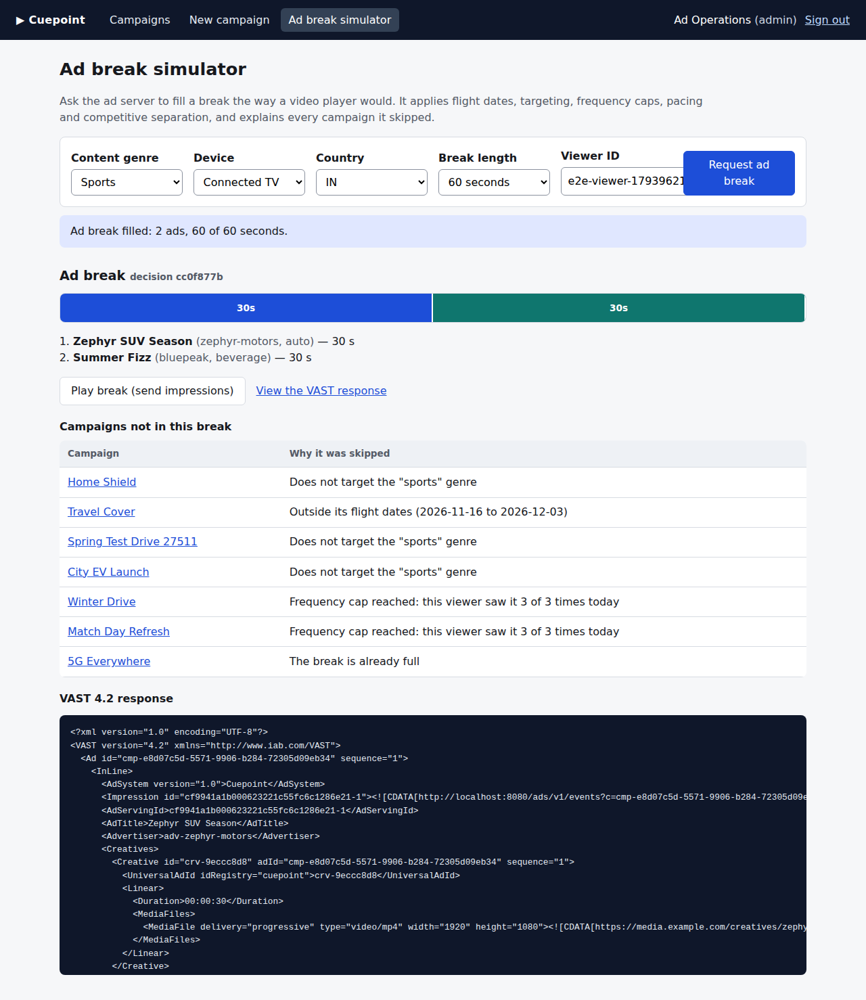
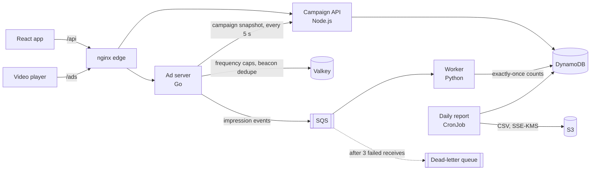
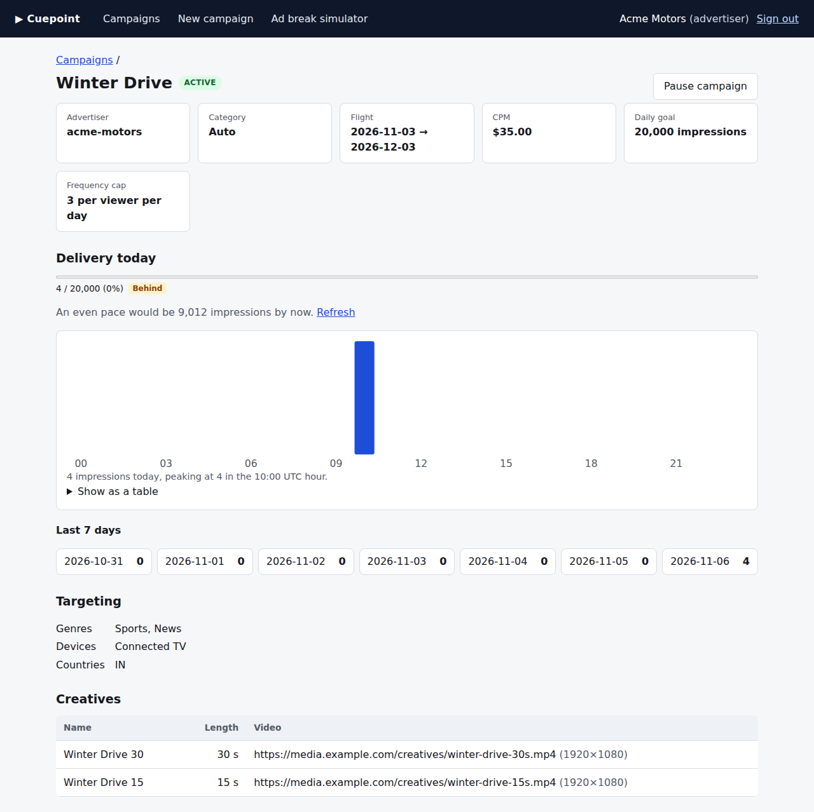
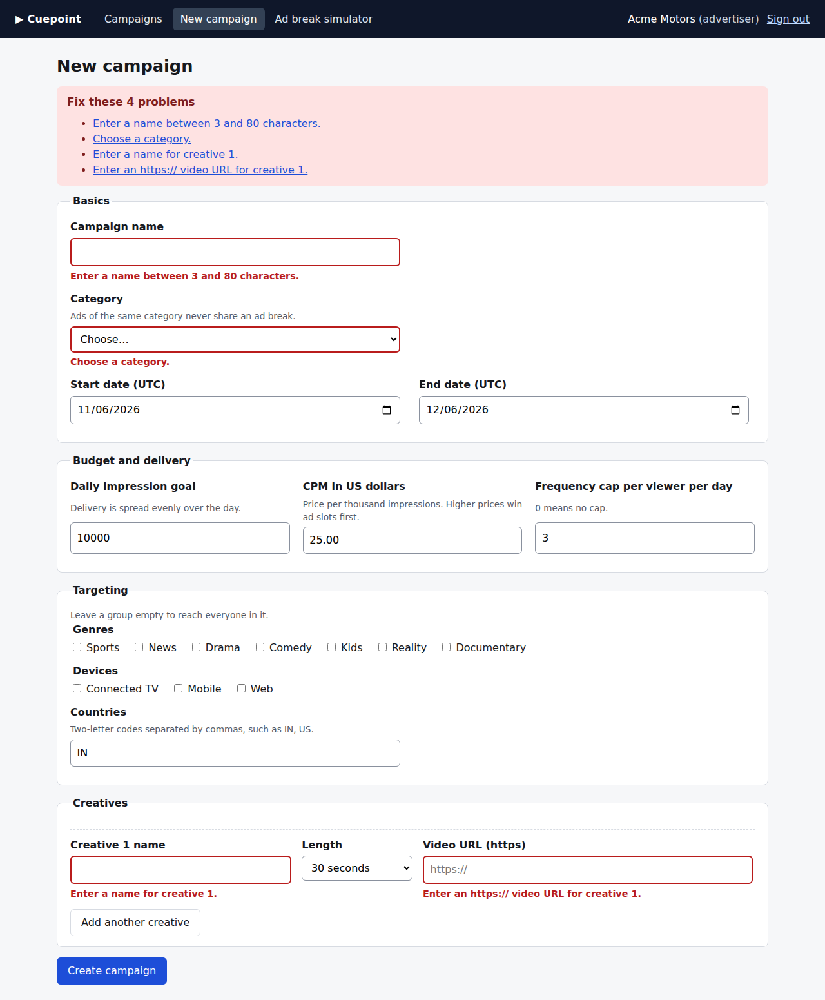

# Cuepoint

[](https://github.com/yasaswinivardhireddy-png/cuepoint/actions/workflows/ci.yml)

A streaming video ad platform:
- **Campaign manager:** advertisers manage campaigns in a **React** app backed by a **Node.js/TypeScript** API.
- **Ad server:** video players get ad breaks from a **Go** ad server that speaks VAST 4.2.
- **Event pipeline:** impressions flow through **SQS** to a **Python** worker that counts each one exactly once in **DynamoDB**, and a daily job writes delivery reports to **S3**.
- **Infrastructure:** the AWS resources are **Terraform**. The services ship as **Docker** images to **Kubernetes**: kind locally and in CI, plus an EKS overlay for production.



## What's in the repo

| Part | Stack | What it does |
|---|---|---|
| [`web/`](web) | React 19, TypeScript, Vite | Campaign manager: create (with validation), pause and resume, hourly and 7-day delivery with pacing status, and an ad break simulator that explains why each campaign was or wasn't picked. Checked against WCAG 2.1 AA with axe. |
| [`api/`](api) | Node.js 24, TypeScript, Fastify | REST API with OpenAPI: JWT sign-in, advertisers scoped to their own campaigns, optimistic concurrency (`If-Match`), delivery and pacing reports, and the campaign snapshot the ad server polls. |
| [`adserver/`](adserver) | Go | Fills an ad break, applying flight dates, targeting, per-viewer frequency caps (Valkey), daily pacing, and one ad per advertiser and category. Returns JSON or VAST 4.2 with signed impression beacons; events go to SQS in batches. |
| [`reporting/`](reporting) | Python 3.12, boto3 | SQS worker that counts each impression exactly once with DynamoDB transactions, plus a daily report job that writes CSV to S3. |
| [`infra/terraform/`](infra/terraform) | Terraform | SQS with a dead-letter queue, three DynamoDB tables (point-in-time recovery, TTL), an S3 bucket encrypted with a customer-managed KMS key, and one least-privilege IAM role per workload. |
| [`deploy/`](deploy) | Kubernetes, kustomize, Prometheus | Base manifests with kind and EKS overlays, network policies, and alert rules with unit tests ([runbook](docs/runbook.md)). |

## Architecture



## Measured in CI

These numbers come from [this CI run](https://github.com/yasaswinivardhireddy-png/cuepoint/actions/runs/42204758973) on a GitHub-hosted runner (4 vCPU, 16 GB). The load generator, the kind cluster (Kubernetes 1.37) and every service share that one machine, so read them as a floor, not a capacity figure.

| Check | Result |
|---|---|
| Ad decision over 500 campaigns (Go benchmark) | 14.8 µs, 6 allocations |
| Ad break requests through the nginx edge on kind (32 clients, 30 s) | 4,677 requests/s; p50 6.2 ms, p95 14.2 ms, p99 19.7 ms; 0 errors in 140,332 requests |
| Counting accuracy: 1,000 impressions, each fired twice | 1,000 counted: 0 missing, 0 double-counted |
| Daily report CronJob | CSV written to S3 with SSE-KMS; totals match the API (1,012 impressions over 9 campaigns) |
| Browser tests on the deployed cluster | 5 Playwright flows, each page checked with axe (WCAG 2.1 AA) |
| Unit and integration tests | Go with the race detector, 17 API tests (including DynamoDB on moto), 13 web, 4 pipeline (on moto), 6 alert-rule tests |

| Campaign detail: pacing and hourly delivery | Form validation with an error summary |
|---|---|
|  |  |

## Design notes

**The hot path never waits on a database.**
- Each ad server keeps an in-memory snapshot of active campaigns and refreshes it every 5 s with a conditional GET (ETag).
- It adds the impressions it served since the last refresh, so pacing stays current between syncs.
- Explanations for skipped campaigns are built only when requested (`debug=1`), keeping a 500-campaign decision at six allocations.

**Every impression counts once.** SQS delivers at least once, and players retry.
- **Stable event IDs:** the beacon's ID is a hash of the decision, campaign and creative, so a replay carries the same ID.
- **Ad server dedupe:** a Valkey `SET NX` drops replays as they arrive.
- **Worker dedupe:** the worker's DynamoDB transaction pairs the counter update with a conditional put of the event ID. A redelivered message can't count twice even if Valkey is lost.
- **Dead-lettering:** malformed messages stay on the queue and move to the dead-letter queue after three receives.

CI checks the whole path: 1,000 impressions, each fired twice, must count exactly 1,000.

**Pacing.**
- A campaign may deliver up to its daily goal times the fraction of the day elapsed, plus 10% headroom.
- Allowances are truncated, not rounded up. In floating point, 500 × 1.1 is 550.0000000000001, so rounding up would allow one extra impression.

**Security.**
- **Signed beacons:** impression beacons are HMAC-signed and expire. Forged beacons get 403; late replays get 410.
- **Advertiser scoping:** advertisers see only their own campaigns. Another advertiser's campaign returns 404, not 403, so IDs can't be probed.
- **Safe edits:** edits need `If-Match` (428 when missing, 412 when stale). Unknown fields are rejected, so server-owned fields can't be mass-assigned.
- **Login rate limit:** keyed on the client IP, read from `X-Forwarded-For` only as far as the trusted proxies (`TRUST_PROXY_HOPS`). Spoofing the header doesn't reset the limit.
- **Least-privilege IAM:** each workload has its own role, allowing only the calls its code makes. On EKS, pods assume it through IRSA, so there are no static keys.
- **Locked-down pods:** pods run under the restricted Pod Security Standard with read-only root filesystems. Ingress is denied by default and opened per path with network policies; kind enforces them in CI.
- **Edge hardening:** nginx blocks internal and metrics routes and sends CSP and security headers.
- **Encryption and scanning:** reports are encrypted with a customer-managed KMS key. CI runs Trivy on the Terraform, the Dockerfiles and the production manifests, plus govulncheck and npm audit on dependencies.

**Operations.**
- **Metrics and alerts:** every service exports Prometheus metrics. [Alert rules](deploy/observability/alerts.yaml) cover decision latency, errors, lost events, stale snapshots, counting lag and the dead-letter queue. Each rule is tested with promtool and linked to a [runbook](docs/runbook.md) entry.
- **Graceful shutdown:** the ad server fails readiness first, finishes in-flight requests, then flushes buffered events.
- **Availability:** the ad server autoscales on CPU, with disruption budgets and zone spreading.

## Run it

Docker Compose runs everything on one machine, with AWS emulated by [moto](https://github.com/getmoto/moto) and set up by the real Terraform:

```sh
docker compose up --build -d          # then open http://localhost:8080
```

Sign in as `admin@cuepoint.dev`, `ads@acmemotors.example` or `ads@bluepeak.example` with the password `cuepoint-demo`.

Kubernetes on kind, the same run as CI (needs docker, kind, kubectl, terraform and jq):

```sh
(cd web && npm ci && npx playwright install chromium)
scripts/e2e-kind.sh
```

Try the API and the ad server through the edge:

```sh
TOKEN=$(curl -s localhost:8080/api/v1/auth/login -H 'content-type: application/json' \
  -d '{"email":"ads@acmemotors.example","password":"cuepoint-demo"}' | jq -r .token)
curl -s localhost:8080/api/v1/campaigns -H "authorization: Bearer $TOKEN" | jq '.items[].name'
curl -s 'localhost:8080/ads/v1/pods?pod=60&genre=sports&device=ctv&country=IN&uid=viewer-1&debug=1' | jq
curl -s 'localhost:8080/ads/v1/pods?pod=60&genre=sports&device=ctv&country=IN&uid=viewer-1&format=vast'
```

The OpenAPI document is [`docs/openapi.json`](docs/openapi.json); the API also serves Swagger UI at `/docs` on its own port.

## Limits

- **Emulated AWS:** CI and local runs use moto in place of AWS. The Terraform targets real AWS (`environments/prod.tfvars.example`) but hasn't been applied to a real account.
- **Demo sign-in:** sign-in uses built-in demo users; production would use an identity provider (OIDC).
- **No Valkey persistence:** a restart resets frequency caps. Counting stays exactly-once because the worker deduplicates.
- **Local load numbers:** load figures come from one shared CI runner, not a production deployment.

## License

[MIT](LICENSE)
